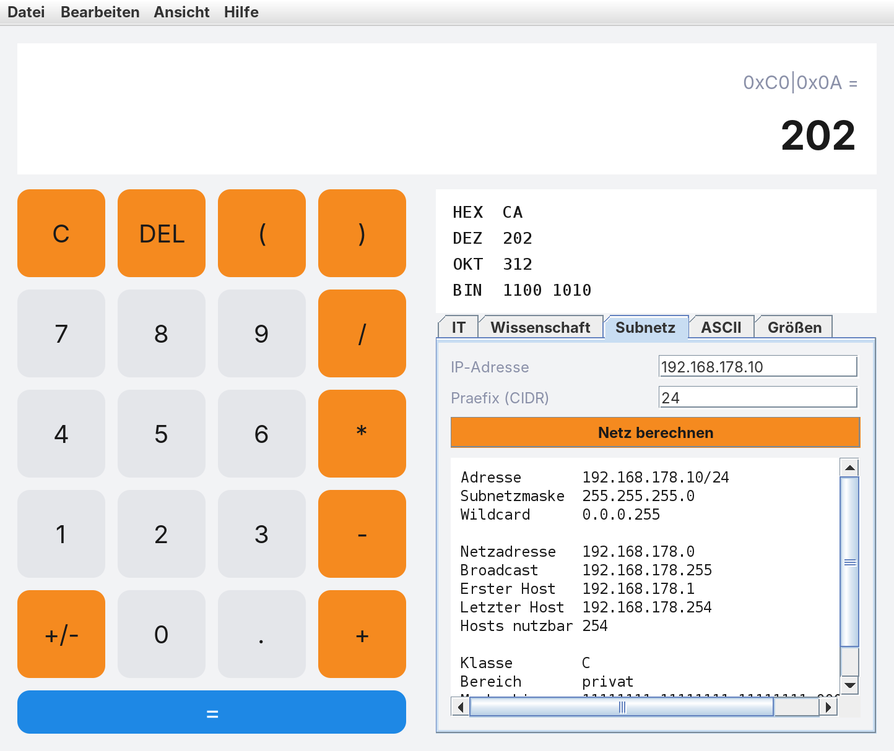
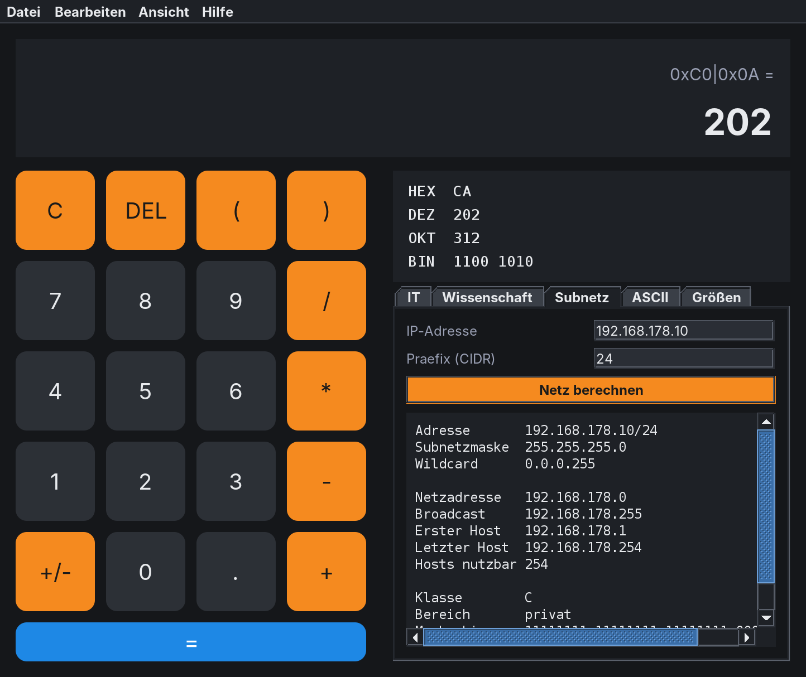

# IT-Rechner

Ein Taschenrechner für IT-Berufe: Grundrechnen, Zahlensysteme, Bit-Operationen, Subnetze, ASCII und Datengrößen in einem Fenster. Entstanden als Schulprojekt in meiner Umschulung zum Fachinformatiker für Systemintegration am BfW Dresden und seitdem weiterentwickelt.



<details>
<summary>Im dunklen Design</summary>



</details>

## Was er kann

- **Rechnen mit Punkt vor Strich und Klammern**, dazu Potenz (`2**8`), Rest (`17%5`) und das letzte Ergebnis als `Ans`
- **Zahlensysteme:** Eingabe als `0xFF`, `0b1010` oder `0o17`. Jedes Ergebnis erscheint zusätzlich in Hex, Dezimal, Oktal und Binär, Binär in Vierergruppen
- **Bit-Operationen:** UND `&`, ODER `|`, XOR `^`, NICHT `~`, Schieben `<<` und `>>`
- **Funktionen:** `sin`, `cos`, `tan` (in Grad), `wurzel`, `ln`, `log`, `abs` und `pi`
- **Subnetzrechner:** Maske, Wildcard, Netz- und Broadcastadresse, Hostbereich, Klasse, privat oder öffentlich, Maske in Binär
- **ASCII:** Zeichen in Zahl und zurück, in allen Zahlensystemen
- **Datengrößen:** KiB, MiB, GiB (Faktor 1024) neben KB, MB, GB (Faktor 1000)
- **Verlauf** aller Rechnungen, auch zum Speichern und Drucken in einem kleinen Editor
- **Helles und dunkles Design:** am Rechner über „Ansicht → Dunkles Design“ oder `Strg+D`, die Wahl bleibt gespeichert. Die Android-App folgt der Einstellung des Handys
- **Tastatur:** Alles lässt sich tippen. `F1` zeigt die Schreibweise, `Shift+F2` die Tastenkürzel, `Strg+I` den erweiterten Modus

Achtung: `^` ist XOR wie in Java, die Potenz schreibt man `**`.

## Herunterladen

Die fertigen Pakete liegen unter [Releases](../../releases):

| System | Datei | Hinweis |
|---|---|---|
| Debian, Ubuntu | `.deb` | `sudo apt install ./it-rechner_*.deb` |
| Fedora, openSUSE | `.rpm` | `sudo dnf install ./it-rechner-*.rpm` |
| Windows | `-windows.zip` | Entpacken und `it-rechner.exe` starten, keine Installation nötig |
| macOS | `.dmg` | Öffnen und in „Programme“ ziehen |
| Alle mit Java 21 | `.jar` | `java -jar it-rechner-*.jar` |
| Android 7 und neuer | `.apk` | Herunterladen und öffnen, die Installation aus dieser Quelle einmal erlauben |

Die Pakete für Linux, Windows und macOS bringen ihre eigene Java-Laufzeit mit.

**Warnung beim ersten Start:** Windows und macOS kennen die Pakete nicht, weil sie nicht mit einem gekauften Zertifikat signiert sind. Unter Windows auf „Weitere Informationen“ und „Trotzdem ausführen“ klicken. Unter macOS das Programm einmal starten, dann in den Systemeinstellungen unter „Datenschutz & Sicherheit“ auf „Dennoch öffnen“ klicken.

**Download prüfen:** Zu jedem Release gehört eine Datei `SHA256SUMS.txt`. Unter Linux prüft `sha256sum -c SHA256SUMS.txt --ignore-missing` die heruntergeladenen Dateien.

## Aufbau

| Datei | Aufgabe |
|---|---|
| `Rechnerkern.java` | Wertet Eingaben aus, als rekursiver Abstieg über die Rangfolge der Operatoren |
| `Subnetting.java` | Rechnet IPv4-Adressen in Zahlen um und leitet daraus Netz, Broadcast und Hostbereich ab |
| `ItRechner.java` | Oberfläche mit Swing |
| `Editor.java` | Kleiner Texteditor für den Verlauf |

Rechenkern und Subnetting hängen nicht von der Oberfläche ab und haben eigene JUnit-Tests unter `src/test`.

## Selbst bauen

Voraussetzung ist ein JDK 21.

```
./gradlew build    # baut und testet
./gradlew run      # startet den Rechner
```

Das fertige JAR liegt danach unter `build/libs/it-rechner.jar`.

## Automatischer Rollout

GitHub Actions baut und testet den Rechner bei jedem Push. Schlägt ein Test fehl, wird der Lauf rot.

Bei einem Versions-Tag wie `v1.3.0` baut der Workflow zusätzlich die Pakete für Linux, Windows und macOS, berechnet die Prüfsummen und legt damit ein Release an:

```
git tag v1.3.0
git push origin v1.3.0
```

Die Actions sind auf Commit-Hashes festgelegt, Dependabot hält sie und die Gradle-Abhängigkeiten aktuell. Nur der Schritt, der das Release anlegt, darf ins Repo schreiben.

## Android

Die Android-App liegt unter `android/`. Sie rechnet mit demselben Kern wie die Desktop-Version und hat eigene Seiten für Subnetze und ASCII. Im Moment liegen Rechenkern und Subnetting dort noch als Kopie, ein gemeinsames Modul für beide Versionen ist der nächste Schritt.

Der Workflow baut und testet die App bei jedem Push. Bei einem Release signiert er sie mit meinem Schlüssel. Der Schlüssel liegt nie im Repo, sondern verschlüsselt in den Secrets des Repos (`ANDROID_KEYSTORE_BASE64`, `ANDROID_KEYSTORE_PASSWORD`, `ANDROID_KEY_ALIAS`, `ANDROID_KEY_PASSWORD`). Nur der Android-Schritt bekommt ihn, und nach dem Bauen wird er wieder gelöscht.
